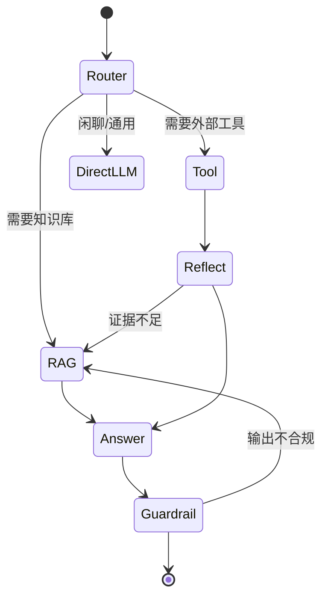

# Agent 设计

## 1. 状态机（LangGraph）

## 2. 工具表（v1）
| name | 用途 | 参数 |
|---|---|---|
| `kb_search` | 知识库检索 | `query: str` |
| `web_search` | 联网搜索 | `query: str` |
| `calculator` | 数值计算 | `expr: str` |
| `db_query` | 只读 SQL 查询 | `sql: str` |

## 3. 规划与反思
- 每轮 Planner 输出一条 JSON 动作
- Reflector 评估：信息充分 → finish；否则给出子问题回到 RAG
- 最大反思轮次：3 次（防无限循环）

## 4. Prompt
- 规划：`config/prompts/agent.yaml#planner_template`
- 反思：`config/prompts/agent.yaml#reflector_template`

## 5. 失败兜底
- 工具超时（>10s）→ 跳过
- 连续 3 次反思失败 → 转人工
- 工具异常 → 标记并继续

## 6. 安全
- 工具权限白名单（白名单内的工具才允许）
- SQL 工具只读，且仅允许查询视图
- Web 搜索结果需 Rerank 后再喂给 LLM

## 7. 可观测

LLM 调用（Planner / Reflector / Answer）的入参/返回日志规范见 [observability.md](./observability.md) §3.1。
