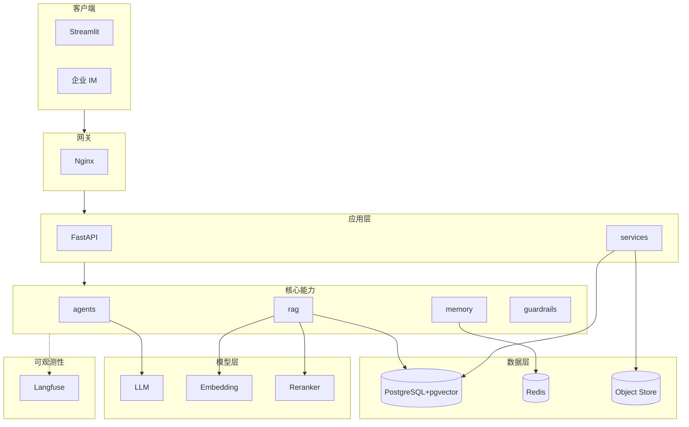
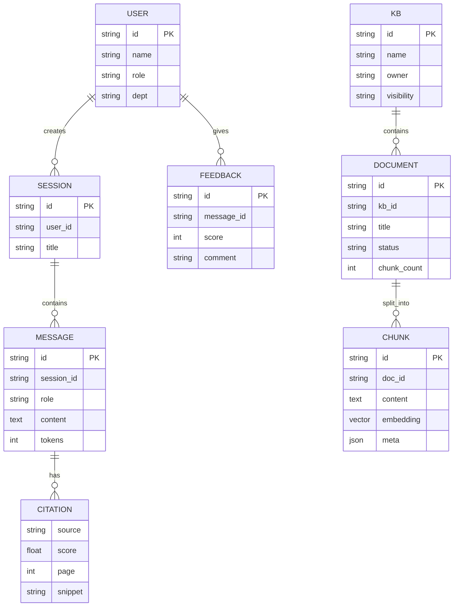

# 系统架构

## 1. 设计原则
1. **配置与代码分离**：所有可变项走 `config/` 与 `.env`，零硬编码
2. **接口与业务解耦**：`api/` 只做参数解析，业务在 `services/`
3. **RAG 与 Agent 解耦**：`rag/` 是无状态检索能力，`agents/` 是有状态编排
4. **全链路可观测**：每个请求带 `X-Trace-Id`，落 Langfuse
5. **失败兜底**：每层都有降级路径，缺一不可

## 2. 整体架构图


## 3. 模块职责

> 布局约定：**顶层多包**（ADR-004），全部业务包平铺在仓库根目录，不使用 `app/` 二级包。

| 模块 | 职责 | 不应做的事 |
|---|---|---|
| `core/` | 配置、日志脱敏、错误码、JWT、中间件 | 业务逻辑 |
| `llm/` | LLM / Embedding / Rerank 的 OpenAI 兼容适配 | 业务规则、数据库访问 |
| `schemas/` | 请求/响应 DTO | 业务逻辑 |
| `ui/` | Streamlit 界面 | 直接访问数据库 |
| `api/` | 协议适配、参数校验、错误码 | 业务逻辑、SQL、模型调用 |
| `services/` | 业务流程编排、事务边界 | 直接调底层 SDK 而不封装 |
| `agents/` | 规划、工具调度、反思 | 直接读写数据库 |
| `rag/` | 文档解析、检索、重排 | 持有会话/用户状态 |
| `memory/` | 上下文裁剪、长期记忆 | 业务规则 |
| `guardrails/` | 输入/输出安全 | 业务判断 |
| `observability/` | Trace、指标 | 业务逻辑 |
| `db/` | ORM、迁移 | 业务规则 |

## 4. 请求生命周期
```
[Client] → Nginx → FastAPI(middleware: TraceId/Auth) → api/chat.py
→ services/chat_service.py
  → guardrails.input_filter.check
  → memory.short_term.load
  → agents.qa_agent.plan
      → rag.retrieve (vector + BM25 + rerank)
      → tools.invoke (web_search / calculator / db_query)
  → llm.generate(stream)
  → guardrails.output_filter.check
  → memory.short_term.save
  → db.persist_message
→ SSE 流式回传
```

## 5. 核心数据模型


## 6. 部署拓扑
- 单机：`docker compose up`（开发 / 中小团队）
- 集群：API 多副本 + 独立 PG/Redis/Langfuse

## 7. 演进约束
- 不允许跨层调用（如 `api/` 直接调 `rag/`）
- 不允许在 `services/` 之外做业务事务
- 任何外部依赖变更必须更新本文档
