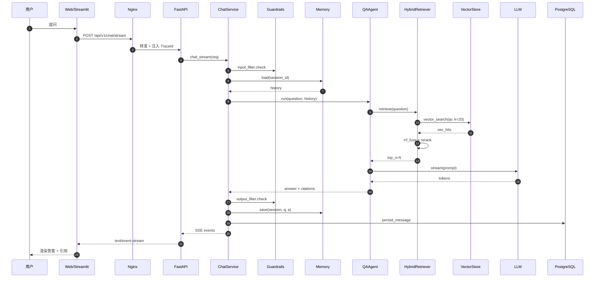

# 端到端数据流

> 跟着"一次问答"走一遍系统。

## 1. 时序图

## 2. 关键路径上的数据形态
| 阶段 | 数据形态 |
|---|---|
| 客户端 | `ChatRequest{ session_id, message, stream }` |
| 检索 | `list[Chunk]{ id, content, score, meta }` |
| Prompt | `[{role:system, content}, {role:user, content:q}, {role:user, content:ctx}]` |
| 流式事件 | `event: token` / `event: citation` / `event: done` |
| 持久化 | `messages{ role, content, citations(json), tokens, latency }` |

## 3. 失败路径
| 失败点 | 兜底策略 |
|---|---|
| LLM 超时 | 重试 2 次 → 切更小模型 → 报错 |
| 检索为空 | 直接 LLM 回答，并标注"无引用" |
| 工具异常 | 跳过该步，标注失败原因继续 |
| Redis 挂 | 退化到无记忆模式（不阻断） |
| PG 写失败 | 异步重试 + 死信队列 |
