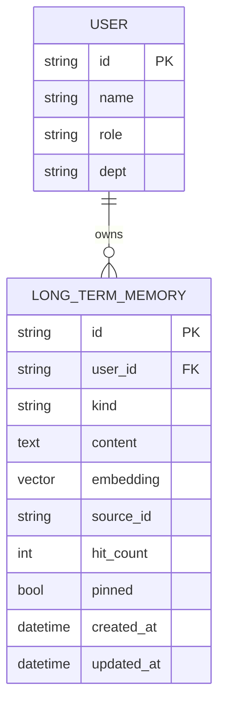
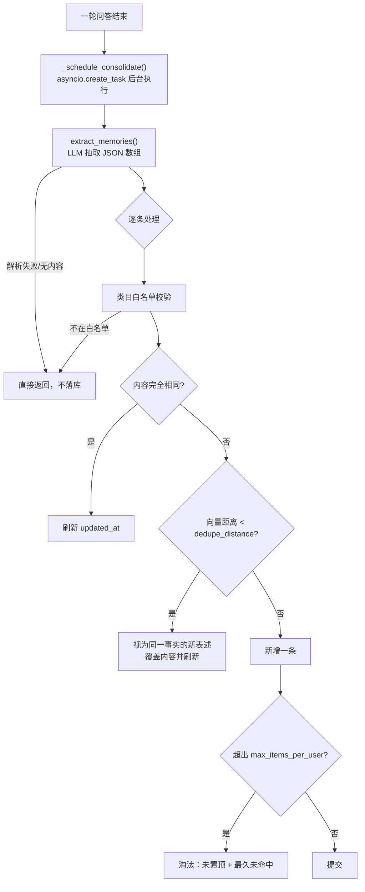
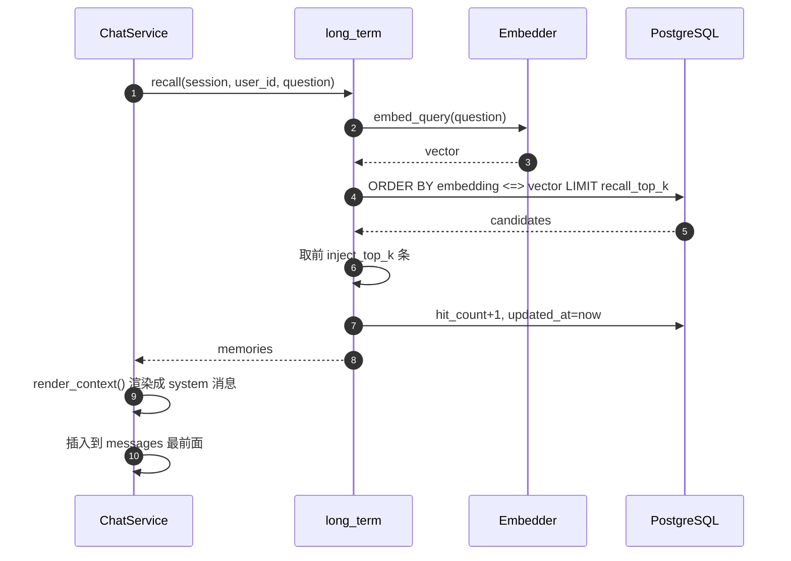

# 长期记忆设计

> 让 SmartQA 记住"这个人是谁、喜欢什么"，而不是只记住"刚才说了什么"。
> 与 `spec.md` 冲突时以 `spec.md` 为准。

## 1. 定位：短期 vs 长期

| 维度 | 短期记忆 `short_term.py` | 长期记忆 `long_term.py`（本模块） |
|---|---|---|
| 作用范围 | 单个会话内 | 跨会话、跨天 |
| 存储 | Redis，TTL 24h；不可用时退化为进程内存 | PostgreSQL + pgvector |
| 写入时机 | 每轮问答结束后同步写入 | 每轮问答结束后**异步**沉淀 |
| 内容 | 原始问答流水 | LLM 抽取后的结构化事实 |
| 读取方式 | 按 session_id 取最近 N 轮 | 按当前问题做**语义召回** top-k |
| 生命周期 | 到期自动丢弃 | 长期保留，直到用户删除或超出配额被淘汰 |

一句话：**短期保证"上下文连贯"，长期保证"认识你这个人"。**

## 2. 数据模型

`db/models.py` → `LongTermMemory`（表 `long_term_memories`）



| 字段 | 说明 |
|---|---|
| `kind` | `profile` 画像 / `preference` 偏好 / `fact` 事实 / `instruction` 长期指令 |
| `content` | 记忆正文，写入时截断到 500 字符 |
| `embedding` | 复用 RAG 的 embedding 模型；**可为 NULL**，此时退化为按更新时间排序 |
| `source_id` | 来源会话 id，便于追溯某条记忆是哪轮对话产生的 |
| `hit_count` | 被召回的次数，用于淘汰策略中的热度排序 |
| `pinned` | 置顶后永不被淘汰，也不参与删除顺序 |

## 3. 写入：抽取 → 去重 → 淘汰



三层抑制机制，保证记忆库不会无限膨胀：

1. **类目白名单** —— `kind` 必须在 `memory.allowed_kinds` 内
2. **精确去重** —— `content` 完全一致则只刷新时间戳
3. **语义去重** —— 余弦距离低于 `dedupe_distance` 视为同一事实的新表述，覆盖而非新增

超出配额时，按 `pinned=False` 且 `hit_count ASC, updated_at ASC` 淘汰。

**关键设计：沉淀用 `asyncio.create_task` 放到后台**，由 `ChatService._BACKGROUND_TASKS` 持有强引用防止被 GC。这样 SSE 的 `done` 事件不会被 LLM 抽取的耗时拖住——用户感知的延迟不变。

## 4. 读取：召回 → 注入



`render_context()` 渲染结果形如：

```
以下是关于该用户的长期记忆，回答时请自然参考，但不要向用户逐条复述这些内容：
- [profile] 用户是后端工程师
- [preference] 回答用中文，尽量简洁
```

以 **system 消息**注入到 `messages` 最前面，因此对 RAG 链路与 Agent 链路**同时生效**（两条路径都汇聚到 `prepare()` 返回前的统一注入点）。

## 5. 配置项

位于 `config/settings.yaml` 的 `memory` 组：

| 键 | 默认 | 说明 |
|---|---|---|
| `long_term_enabled` | `true` | 总开关，关闭后既不沉淀也不注入 |
| `extract_enabled` | `true` | 是否用 LLM 抽取；关闭后只能通过 API 手动写入 |
| `inject_top_k` | `5` | 单次注入的最大条数 |
| `recall_top_k` | `20` | pgvector 候选召回数，需 ≥ `inject_top_k` |
| `max_items_per_user` | `200` | 单用户配额上限 |
| `dedupe_distance` | `0.12` | 余弦距离阈值，越小越严格 |
| `allowed_kinds` | `[profile, preference, fact, instruction]` | 类目白名单 |

Prompt 模板集中在 `config/prompts/memory.yaml`（`inject_header` / `extract_template`），代码里均带兜底字符串，缺失模板不会导致功能失效。

## 6. 接口

全部需要 JWT，且**只能在本人数据范围内操作**。

| 方法 | 路径 | 说明 |
|---|---|---|
| `GET` | `/api/v1/memory` | 列出我的长期记忆（含 `enabled` 状态） |
| `POST` | `/api/v1/memory` | 手动添加一条 |
| `DELETE` | `/api/v1/memory/{memory_id}` | 删除单条（**被遗忘权**） |
| `DELETE` | `/api/v1/memory` | 清空我的全部记忆 |

详见 [api.md](./api.md#6-长期记忆)。Streamlit 侧边栏的「🧠 长期记忆」开关已接入上述四个接口，可直接在界面上查看与管理。

## 7. 失败与安全

| 场景 | 行为 | 原因 |
|---|---|---|
| LLM 抽取失败 | 记录 WARNING，本轮不沉淀 | 不得影响已经给出的回答 |
| 抽取结果解析失败 | 返回空列表 | 与 `router` 一致的宽容解析策略 |
| Embedding 不可用 | `embedding=NULL`，退化为按 `updated_at` 排序 | 语义能力降级但不失效 |
| 召回抛异常 | `_with_memories` 捕获后原样返回 messages | 记忆是增强项，不是必需项 |
| 后台任务异常 | `add_done_callback` 清理集合，不污染主链路 | 避免内存泄漏 |

隐私设计：
- 抽取模板明确要求**不记录**密码、密钥、证件号、银行卡号
- 所有长期记忆接口**强制按 user_id 隔离**，无法读写他人记忆
- 用户可通过 DELETE 接口行使被遗忘权

## 8. 测试

`tests/test_long_term_memory.py`（18 个用例）：

- `_parse_memories` 的宽容解析（代码块包裹、`json` 前缀、前后废话、非法 JSON、混入非法元素等 10 种输入）
- `render_context` 的空输入与渲染行数
- `extract_memories` 的正常解析、LLM 失败降级、`extract_enabled=false` 短路
- 接口未携带 Token 时的 401

需要真实 Postgres/pgvector 的 `consolidate` / `recall` 未纳入单测，避免 CI 依赖外部数据库。

## 9. 后续演进

- [ ] 记忆冲突消解：新记忆与旧记忆矛盾时（如换了公司），按时间加权替换而非简单覆盖
- [ ] 摘要压缩：同一 `kind` 下条目过多时合并成摘要
- [x] 在 UI（Streamlit）侧展示与管理记忆（侧边栏「🧠 长期记忆」面板）
- [ ] 按 `kind` 差异化 `inject_top_k`（画像类少量常驻，事实类按需召回）
