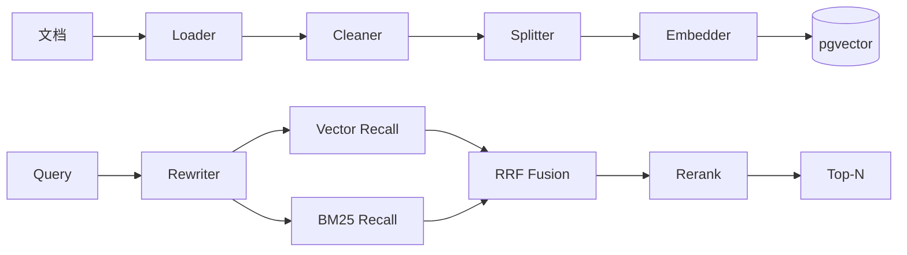

# RAG 设计

## 1. 设计目标
- 召回率@5 ≥ 0.85
- 答案忠实度（Faithfulness）≥ 0.9
- 引用准确率 ≥ 0.95
- p95 端到端延迟 ≤ 3s（非流式首字 ≤ 1.5s）

## 2. 流水线


## 3. 分块策略
| 文档类型 | 策略 | chunk_size | overlap |
|---|---|---|---|
| 通用 | Recursive | 512 | 64 |
| 长报告/手册 | Semantic | 768 | 0 |
| 表格 | 整表保留 | - | - |
| 代码 | 按函数/类 | 1024 | 64 |

每个 chunk 携带元数据：`source_uri, page, kb_id, doc_id, chunk_index`

## 4. 检索策略
- 向量召回：`top_k=20`，余弦相似
- BM25 召回：`top_k=20`，基于语料缓存
- 融合：RRF, k=60
- Rerank：取 top_n=5，模型 `bge-reranker-v2-m3`
- 权限过滤：按用户部门/角色对 `kb.visibility` 二次过滤

## 5. Prompt 模板
见 `config/prompts/rag.yaml`：
```
你是 SmartQA。请严格基于以下"知识片段"回答问题。
要求：
1. 仅使用片段中的事实，不要外推
2. 答案末尾用 [1][2] 标注引用
3. 若片段不足以回答，回复：知识库未覆盖此问题
```

## 6. 评估
- 离线：`scripts/run_eval.py`，指标包括 faithfulness / citation_acc / recall@5
- 在线：消息列表可"👍 / 👎"反馈，结果回流评估集

## 7. 已知问题与对策
| 问题 | 对策 |
|---|---|
| 召回不准 | 加 Rerank、调整 chunk_size |
| 上下文超长 | 二次压缩/摘要 |
| 多语言混排 | Embedding 选 multilingual |
| 表格理解差 | 表格转 Markdown + caption |
