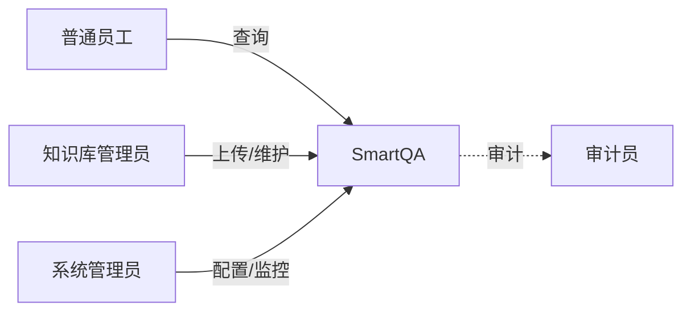
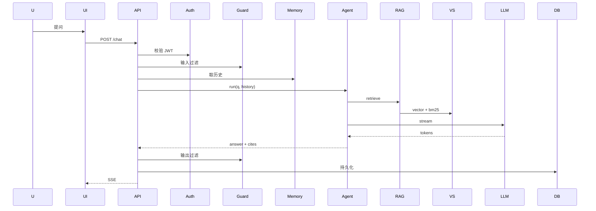

# SmartQA — 项目规范说明书（Specification）

> 本文件是 SmartQA 的**产品 + 工程 + 验收**三层合一的单一事实源（Single Source of Truth）。
> 任何与本文档不一致的实现、文档、决策，必须先修改本文档再动手。

| 字段 | 值 |
|---|---|
| 项目名 | SmartQA |
| 版本 | 0.1.0（Draft） |
| 状态 | 进行中 |
| 负责人 | @架构组 |
| 最后更新 | 2026-10-15 |

---

## 1. 背景与目标

### 1.1 背景
企业内部存在大量散落在 Wiki、PDF、邮件、工单系统中的知识，员工查找信息平均耗时 5–10 分钟，且经常因找不到资料而重复提问同事。LLM 与 RAG 技术的成熟，使"自然语言提问 → 准确给出答案并附引用"成为可能。

### 1.2 目标
构建一个**企业级智能问答助手**，让员工用自然语言提问，秒级获得基于企业私有知识的答案，并附引用。

### 1.3 成功指标（KPI）
| 指标 | 目标值 | 测量方式 |
|---|---|---|
| 答案采纳率 | ≥ 80% | 👍 / (👍+👎) |
| 首字延迟 p95 | ≤ 1.5s | Langfuse trace |
| 端到端延迟 p95 | ≤ 3s | Langfuse trace |
| 召回率@5 | ≥ 0.85 | 离线评估集 |
| 答案忠实度 | ≥ 0.90 | 离线评估集 |
| 月活用户 | ≥ 500 | 管理后台 |
| 月提问量 | ≥ 20,000 | 管理后台 |

---

## 2. 范围

### 2.1 In Scope（MVP 必须）
- 基于企业私有文档的 RAG 问答
- 多轮对话与上下文记忆
- 工具调用（联网搜索、数值计算、只读 SQL 查询）
- 流式输出（SSE）
- 答案引用溯源
- 用户/角色管理（RBAC）
- 知识库管理（上传/列表/删除）
- 可观测性（Trace、Token、延迟）
- 离线评估与人工反馈
- Web 聊天界面（Streamlit）
- IM 接入（飞书/钉钉，P4）

### 2.2 Out of Scope（本期不做）
- 多模态（图片/视频问答）
- 主动推送（订阅、提醒）
- Agent 自主修改知识库
- 跨语言实时翻译
- 移动端原生 App

### 2.3 假设
- 企业已购买 LLM API 配额或具备私有部署算力
- 知识库文档总量 ≤ 100 万 chunks
- 内部已具备统一的用户身份系统（SSO/LDAP）

---

## 3. 用户与场景

### 3.1 用户角色

### 3.2 用户故事（User Story）

#### 角色：普通员工 `employee`
- **US-001**：作为员工，我希望能用自然语言提问（如"年假几天"），获得基于公司制度的准确答案。
- **US-002**：作为员工，我希望答案中能附上来源链接，方便我点击核实。
- **US-003**：作为员工，我希望支持多轮追问（如"那病假呢？"），系统能理解上下文。
- **US-004**：作为员工，我希望提问时不暴露给同部门以外的人（权限隔离）。

#### 角色：知识库管理员 `kb_admin`
- **US-101**：作为管理员，我希望能上传 PDF/Word/Excel 文档，让系统自动学习。
- **US-102**：作为管理员，我希望能查看每个文档的处理状态与 chunk 数量。
- **US-103**：作为管理员，我希望能删除过期文档，并触发向量库清理。

#### 角色：系统管理员 `admin`
- **US-201**：作为系统管理员，我能查看每日的调用量、Token 用量、错误率。
- **US-202**：作为系统管理员，我能配置 LLM 模型、提示词等参数，无需改代码。
- **US-203**：作为系统管理员，我能导出某用户的全部对话（合规要求）。

---

## 4. 功能性需求（FR）

| 编号 | 名称 | 优先级 | 验收标准 | 关联文档 |
|---|---|---|---|---|
| FR-01 | 单轮问答 | P0 | 输入问题 ≤ 5s 返回非空答案 | api.md |
| FR-02 | 多轮对话 | P0 | 3 轮内指代消解正确 | dataflow.md |
| FR-03 | 知识库检索 | P0 | 召回率@5 ≥ 0.85 | rag_design.md |
| FR-04 | 答案引用 | P0 | 每个事实点可追溯到 chunk | rag_design.md |
| FR-05 | 流式输出 | P0 | 首字 ≤ 1.5s | api.md |
| FR-06 | 工具调用 | P1 | 复杂问题能拆解并执行 | agent_design.md |
| FR-07 | 文档上传 | P1 | 支持 PDF/DOCX/XLSX/MD | api.md |
| FR-08 | 鉴权（JWT） | P1 | 无 Token 拒绝 | security.md |
| FR-09 | RBAC | P1 | 用户仅可见权限内 KB | security.md |
| FR-10 | 提示注入防御 | P1 | 注入测试集 0 误答 | security.md |
| FR-11 | 观测与 Trace | P1 | Langfuse 100% 覆盖 | deployment.md |
| FR-12 | 反馈闭环 | P2 | 👍/👎 持久化 | roadmap.md P3 |
| FR-13 | 离线评估 | P2 | eval 集可一键跑 | roadmap.md P3 |
| FR-14 | IM 集成 | P2 | 飞书/钉钉消息可触发 | roadmap.md P4 |
| FR-15 | 多租户 | P2 | 数据按部门隔离 | roadmap.md P4 |

---

## 5. 非功能性需求（NFR）

| 类别 | 指标 | 目标值 |
|---|---|---|
| 性能 | 首字延迟 p95 | ≤ 1.5s |
| 性能 | 端到端 p95 | ≤ 3s |
| 性能 | 并发（单机） | ≥ 50 QPS |
| 可用性 | 月度 SLA | ≥ 99.5% |
| 可靠性 | LLM 失败兜底 | 100% 有降级 |
| 安全 | 鉴权覆盖率 | 100% 非公开接口 |
| 安全 | 日志脱敏 | 100% PII 字段 |
| 可维护 | 单元测试覆盖率 | ≥ 60% |
| 可观测 | 关键路径 Trace | 100% |
| 成本 | 单次问答 Token | ≤ 2k（avg） |
| 兼容 | Python | 3.11+ |
| 兼容 | 浏览器 | Chrome/Edge/Safari 最近 2 版 |

---

## 6. 关键流程

### 6.1 问答主流程

### 6.2 文档入库流程

---

## 7. 数据模型（高层）

完整 ER 见 `docs/architecture.md#5`，核心实体：
- `User` { id, name, role, dept }
- `ChatSession` { id, user_id, title }
- `Message` { id, session_id, role, content, citations, tokens }
- `KnowledgeBase` { id, name, owner, visibility }
- `Document` { id, kb_id, title, source_uri, status, chunk_count }
- `Chunk` { id, doc_id, content, embedding, meta }
- `Feedback` { id, message_id, score, comment }

---

## 8. 接口契约

详见 `docs/api.md`。关键约束：
- 统一前缀 `/api/v1`
- 错误码 `BIZ_XXX`
- 流式 SSE 事件：`citation` / `token` / `done`
- 鉴权 Header：`Authorization: Bearer <token>`

---

## 9. 验收标准（Definition of Done）

每条 FR 必须同时满足：

- [ ] 代码已合入主分支
- [ ] 单元测试通过，覆盖率达标
- [ ] API 文档（OpenAPI）已更新
- [ ] 已接入 Langfuse，能在 UI 看到 trace
- [ ] 已写 `docs/xxx_design.md` 关键决策
- [ ] 离线评估集指标达标
- [ ] 至少有 1 位 reviewer 通过
- [ ] 灰度环境跑通真实数据 7 天

---

## 10. 约束与依赖

### 10.1 技术约束
- 后端必须 Python 3.11+
- 必须使用 LangChain/LangGraph 编排
- 向量库先用 pgvector，规模超限再迁移
- 前端 MVP 阶段必须是 Streamlit

### 10.2 外部依赖
| 依赖 | 用途 | 备选方案 |
|---|---|---|
| LLM API | 文本生成 | OpenAI / DeepSeek / Qwen |
| Embedding | 向量化 | OpenAI / BGE |
| PG | 关系库 + 向量 | MySQL + Milvus |
| Redis | 缓存/会话 | - |
| Langfuse | 可观测 | 自研 |

### 10.3 团队约束
- 所有 PR 必须 review
- 主分支必须 CI 通过
- 涉及架构调整先改 `spec.md`

---

## 11. 风险与对策

| 风险 | 等级 | 对策 |
|---|---|---|
| LLM 服务不可用 | 高 | 多模型路由 + 兜底模板 |
| 提示注入 | 高 | 输入过滤 + 输出复核 + 沙箱工具 |
| 知识库内容过时 | 中 | 版本管理 + 定期提醒 |
| 召回质量不达标 | 中 | 加 Rerank + 调 chunk 策略 + 评估闭环 |
| 成本失控 | 中 | Token 限速 + 缓存 + 提示词压缩 |
| 用户问敏感数据 | 中 | 权限过滤 + 输出脱敏 |
| IM 集成方接口变更 | 低 | 适配层 + 监控告警 |

---

## 12. 里程碑

见 `docs/roadmap.md`：
- P0（W1）骨架
- P1（W2-3）RAG
- P2（W4）Agent
- P3（W5-6）工程化
- P4（W7+）集成

---

## 13. 变更记录

| 日期 | 版本 | 变更 | 作者 |
|---|---|---|---|
| 2026-10-15 | 0.1.0 | 初始版本 | @架构组 |

---

## 附录 A：术语表

| 术语 | 含义 |
|---|---|
| RAG | Retrieval-Augmented Generation，检索增强生成 |
| Chunk | 文档被切分后的最小检索单元 |
| Embedding | 文本的稠密向量表示 |
| Rerank | 对召回结果二次排序 |
| RRF | Reciprocal Rank Fusion，融合多路召回 |
| pgvector | PostgreSQL 的向量扩展 |
| LangGraph | LangChain 的状态机编排库 |
| SSE | Server-Sent Events，服务端推送 |
| RBAC | Role-Based Access Control |

## 附录 B：相关文档索引

- [README.md](./README.md) — 项目总览
- [docs/README.md](./docs/README.md) — 文档中心
- [docs/architecture.md](./docs/architecture.md) — 系统架构
- [docs/api.md](./docs/api.md) — 接口规范
- [docs/rag_design.md](./docs/rag_design.md) — RAG 设计
- [docs/agent_design.md](./docs/agent_design.md) — Agent 设计
- [docs/security.md](./docs/security.md) — 安全
- [docs/deployment.md](./docs/deployment.md) — 部署
- [docs/roadmap.md](./docs/roadmap.md) — 路线
